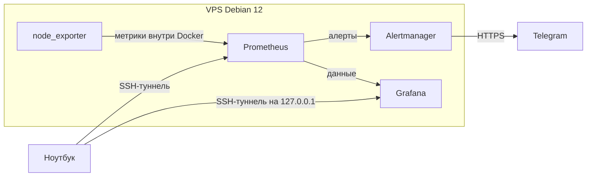

# Мониторинг сервера

Учебный стек для портфолио: один VPS на Debian 12 сам рассказывает, жив ли он. Prometheus собирает метрики, Grafana рисует дашборд, Alertmanager пишет в Telegram, если серверу плохо.

Файлы стека уже в репозитории. На VPS его ещё не запускали: с этой машины сервер недоступен, адреса в проекте нет. Порядок сборки — в [docs/PLAN.md](docs/PLAN.md).

## Схема



Grafana, Prometheus и Alertmanager слушают только localhost на сервере. С ноутбука их открывает туннель, пока жива SSH-сессия. Почему не Nginx с паролем: [docs/DECISIONS.md](docs/DECISIONS.md).

## Секреты

```bash
cp .env.example .env
```

Дальше на VPS впиши токен, chat_id и пароль Grafana. Как завести бота у @BotFather и как узнать chat_id: [docs/SECURITY.md](docs/SECURITY.md). В git эти значения не коммитятся.

## Алерты

| Имя | Когда пишем в Telegram | Почему такой порог |
|---|---|---|
| InstanceDown | экспортёр молчит 1 минуту | сервер или агент метрик недоступен |
| HighCpu | CPU выше 85% пять минут | короткий пик на деплое — не авария |
| HighMemory | занято больше 90% доступной памяти пять минут | кэш Linux в счёт не берём |
| HighDisk | раздел заполнен больше чем на 85% десять минут | остаётся запас, чтобы почистить диск |
| HighLoad | нагрузка за минуту выше числа ядер пять минут | очередь задач длиннее, чем процессор успевает |

Подробнее формулы: [docs/DECISIONS.md](docs/DECISIONS.md).

## Как запустить

Команды ниже выполняются на VPS (Debian 12), в каталоге с этим репозиторием. На Windows Docker не используем.

```bash
cp .env.example .env
# Впиши TELEGRAM_BOT_TOKEN, TELEGRAM_CHAT_ID и GF_SECURITY_ADMIN_PASSWORD.

python3 scripts/render-alertmanager.py
docker compose config
docker compose up -d
docker compose ps
```

`render-alertmanager.py` берёт шаблон `alertmanager/alertmanager.yml.tmpl` и записывает `alertmanager/alertmanager.yml`. Во втором файле уже лежит токен, поэтому он в `.gitignore`. Если запустить `docker compose up` до скрипта, Docker может создать каталог вместо файла. Тогда останови стек, удали этот каталог и собери конфиг скриптом.

Проверка, что цели и правила на месте:

```bash
curl -s http://127.0.0.1:9090/api/v1/targets
curl -s http://127.0.0.1:9090/api/v1/rules
curl -s http://127.0.0.1:9093/api/v2/status
```

У цели `node` должно быть `health` равное `up`. В правилах — пять имён: InstanceDown, HighCpu, HighMemory, HighDisk, HighLoad.

UI с ноутбука:

```bash
ssh -L 3000:127.0.0.1:3000 -L 9090:127.0.0.1:9090 -L 9093:127.0.0.1:9093 user@vps
```

- Grafana: http://127.0.0.1:3000
- Prometheus: http://127.0.0.1:9090
- Alertmanager: http://127.0.0.1:9093

## Как проверить, что алерт живой

На VPS поставь генератор нагрузки и запусти демо:

```bash
sudo apt-get update && sudo apt-get install -y stress-ng
sh scripts/stress-demo.sh
```

Скрипт занимает все ядра на 12 минут. Формула HighCpu смотрит среднее за 5 минут и ещё 5 минут ждёт, что загрузка не спала, поэтому короткого всплеска мало. В Telegram придёт сообщение «ПРОБЛЕМА: HighCpu». После окончания нагрузки придёт «ПОЧИНИЛОСЬ». Остановить раньше времени: Ctrl+C. Пока скрипт работает, сервер будет тормозить.

## Проверки в CI

На каждый push и pull request GitHub Actions делает две вещи.

1. `python -m unittest discover -s tests -v` — шаблон без токена, хук не пускает `git add .env`, порты UI только на `127.0.0.1`, пять алертов на месте, JSON дашборда читается. Docker для этого не нужен, поэтому команда работает и на Windows.
2. `sh scripts/check-docker.sh` — уже на сервере GitHub, где Docker есть. `promtool` проверяет конфиг Prometheus и правила, `amtool` проверяет собранный Alertmanager, `docker compose config` проверяет чертёж. Токен в этом шаге фиктивный и после проверки удаляется.

Живой VPS эти тесты не заменяют: они не ходят в Telegram и не снимают дашборд.

## Чеклист

- [x] Доступ через SSH-туннель, порты не в интернет
- [x] Список алертов и пороги
- [x] `.env.example` без секретов
- [x] Compose и четыре сервиса
- [x] Правила Prometheus
- [x] Alertmanager → Telegram
- [x] Дашборд Grafana из файлов
- [x] Демо-нагрузка stress-ng
- [x] CI: тесты файлов и проверка конфигов promtool/amtool
- [ ] Проверка на VPS и скриншот
